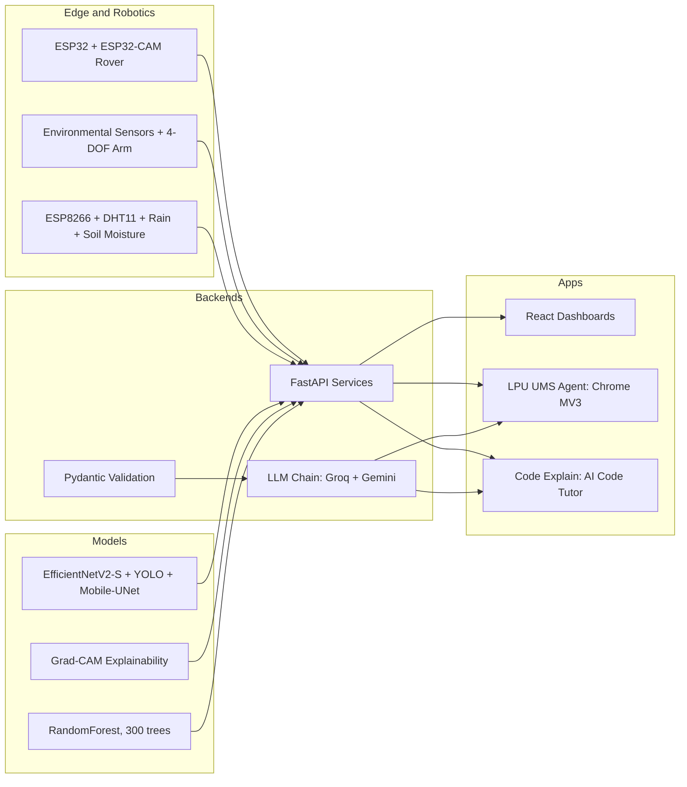
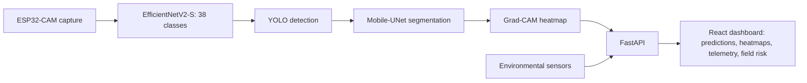
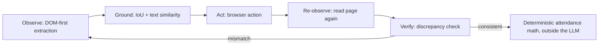
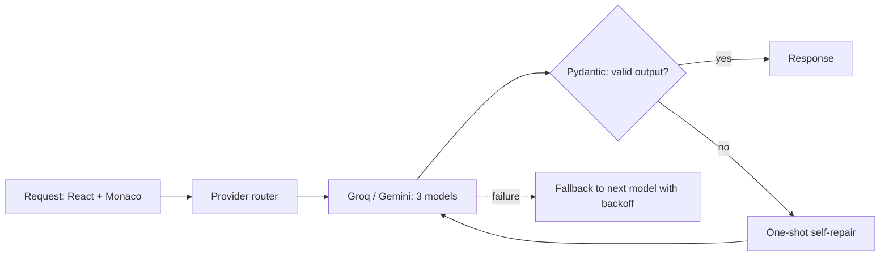

<div align="center">


<br/>

<p>
  
  &nbsp;
  
  &nbsp;
  
  &nbsp;
  
  &nbsp;
  
</p>

<p>
  <a href="https://linkedin.com/in/mohammadfayaskhan" target="_blank">
    
  </a>
  &nbsp;
  <a href="mailto:fayaskhanmohammad@gmail.com">
    
  </a>
  &nbsp;
  <a href="https://github.com/MohammadFayasKhan" target="_blank">
    
  </a>
  &nbsp;
  <a href="https://leetcode.com/u/fayaskhanx/" target="_blank">
    
  </a>
</p>


&nbsp;

&nbsp;


</div>

<br/>

---

## `01` // whoami

I am a **Computer Science Engineering** student at **Lovely Professional University** (B.Tech, 2024 to 2028) with a **9.66 CGPA**, a place on the **University Honor Roll 2025**, and an **AI/ML Minor**. I build AI systems that run in the real world: a vision-powered field rover with a robotic arm, an agentic assistant that operates inside live browser sessions, an LLM code tutor deployed with Docker, ML models served from Hugging Face, and ESP8266 devices with native Apple HomeKit.

My work spans the full stack, from ESP32 and ESP8266 sensors streaming into FastAPI backends, to PyTorch vision pipelines with Grad-CAM explainability, to React dashboards on Vercel and Render. I led **Team Innovex** into the **top 30 hardware teams out of 900+** at **LPU GearUp Season 5**, completed the **AI Engineer Launchpad** (50 hours on LLMs and agentic AI), cleared the **JPMorgan Chase Code For Good** HackerRank round, and contribute to open source through **GSSoC '26**.

I solve DSA in **C++** (Striver A2Z roadmap), build AI/ML systems in **Python**, and develop web applications with **React, TypeScript, FastAPI, and Node.js**.

| | |
|---|---|
| 🎓 **Education** | B.Tech CSE, Lovely Professional University, Phagwara, Punjab (Aug 2024 to 2028), CGPA 9.66 |
| 🧠 **Core focus** | Computer Vision, LLMs, Agentic AI, RAG, applied ML on edge hardware |
| 🛠️ **Build style** | End-to-end: model → API → dashboard → deployment, with deterministic logic kept outside the LLM |
| 🏆 **Leadership** | Team Leader, Team Innovex (LPU GearUp Season 5, top 30 hardware teams of 900+) |
| 🌍 **Open source** | Accepted contributor, GSSoC '26 |

**Open to:** SWE Internships · AI/ML Roles · Open Source Collaborations

---

## `02` // system map



---

## `03` // tech stack

### Languages

<p>
  
</p>

### AI / ML & Data Science

<p>
  
  &nbsp;
  
  &nbsp;
  
  &nbsp;
  
  &nbsp;
  
  &nbsp;
  
</p>

### LLMs & Agentic AI

<p>
  
  &nbsp;
  
  &nbsp;
  
  &nbsp;
  
  &nbsp;
  
  &nbsp;
  
  &nbsp;
  
</p>

### Frontend

<p>
  
</p>

### Backend & Databases

<p>
  
</p>

### Embedded Systems, IoT & Robotics

<p>
  
  &nbsp;
  
  &nbsp;
  
  &nbsp;
  
  &nbsp;
  
  &nbsp;
  
</p>

### DevOps & Tooling

<p>
  
  &nbsp;
  
</p>

---

## `04` // AI / ML expertise

| Domain | Details |
|---|---|
| **Computer Vision** | EfficientNetV2-S classification, YOLO detection, Mobile-UNet segmentation, Grad-CAM explainability, OpenCV, dlib face recognition, TCS3200 color sensing, ESP32-CAM integration |
| **Deep Learning** | CNNs, EfficientNetV2-S, MobileNetV2 (applied), PyTorch |
| **LLMs & NLP** | Transformers, BERT, GPT concepts, tokenization, prompt engineering, LLM APIs, structured outputs, in-context learning, OCI AI services |
| **Agentic AI & RAG** | Function / tool calling, closed-loop agents (observe → ground → act → re-observe → verify), RAG, LoRA/QLoRA fine-tuning, LLM evaluation and guardrails, LangChain, LangGraph |
| **Machine Learning** | RandomForest, GridSearchCV, cross-validation, OOB scoring, feature importance analysis |
| **Applied ML + IoT** | Sensor-to-model pipelines, real-time inference (27ms avg latency), zero train-deploy feature mismatch |
| **Data Science** | Pandas, NumPy, Matplotlib, EDA, hypothesis testing, probability and statistics |
| **Cloud AI & Deployment** | Oracle Cloud Infrastructure AI and Agentic AI Foundations (Certified), Hugging Face Spaces, Render, Vercel, Docker |

---

## `05` // featured projects

<details open>
<summary><b>🌾 AI Powered Crop Intelligence Rover: Leaf Disease Detection and Field Risk Monitoring</b></summary>

<br/>

> A field rover that sees, senses and explains: leaf disease detection with explainable AI, live sensor telemetry, and voice interaction in one dashboard.

| Attribute | Detail |
|---|---|
| **Period** | Sep 2026 to Oct 2026 |
| **Classifier** | EfficientNetV2-S trained on ~54K images across 38 classes |
| **Results** | **95.13%** test accuracy, **0.9354** Macro F1 |
| **Extended Pipeline** | YOLO detection, Mobile-UNet segmentation, Grad-CAM heatmaps |
| **Hardware** | ESP32 + ESP32-CAM rover, environmental sensors, 4-DOF robotic arm for close-up inspection and image capture |
| **Voice** | Field interaction through XiaoZhi AI Assistant |
| **Serving** | FastAPI inference + React dashboard (disease predictions, Grad-CAM heatmaps, sensor telemetry, field-risk insights) |
| **Stack** | Python, PyTorch, YOLO, FastAPI, React, ESP32, ESP32-CAM, IoT, Robotics |
| **Recognition** | LPU GearUp Season 5: Team Innovex, top 30 hardware teams out of 900+ |
| **Repository** | [AIPoweredCropIntelligenceRover](https://github.com/MohammadFayasKhan/AIPoweredCropIntelligenceRover) |
| **Live Site** | [aipoweredcropintelligencerover.dpdns.org](https://aipoweredcropintelligencerover.dpdns.org) |
| **Demo Video** | [Watch on YouTube](https://youtu.be/BdzizjHH6jI) |



**Engineering highlight:** Detection is only half the job. Grad-CAM shows *why* a leaf was flagged, and field-risk insights combine image predictions with live sensor telemetry instead of relying on the image alone.

</details>

<details open>
<summary><b>🧭 LPU UMS Agent: Agentic AI Assistant and Task Automation for LPU UMS</b></summary>

<br/>

> An agentic Chrome extension that works inside live LPU UMS sessions and automates attendance analysis, exam date-sheets and seating plans.

| Attribute | Detail |
|---|---|
| **Period** | Aug 2026 to Oct 2026 |
| **Workflows** | 3 automated workflows: attendance analysis, exam date-sheet, seating plan |
| **Extraction** | DOM-first extraction with discrepancy validation across legacy tabular and Angular card layouts |
| **Agent Loop** | Closed loop: observe → ground → act → re-observe → verify, with IoU and text-similarity grounding |
| **Safety** | Human-controlled CAPTCHA and security handling; attendance calculations stay deterministic and outside the LLM |
| **Privacy** | IndexedDB local storage, stateless FastAPI backend, no credential or cookie handling, minimal course context sent |
| **Reliability** | 3-model LLM fallback chain, **139 automated tests** |
| **Stack** | Python, TypeScript, React, Chrome Extension APIs (MV3), FastAPI, IndexedDB, LLM APIs, Browser Automation |
| **Repository** | [LpuUmsAgent](https://github.com/MohammadFayasKhan/LpuUmsAgent) |



**Engineering highlight:** The LLM never touches the numbers that matter. It helps with understanding and presentation, while calculations stay deterministic and security steps stay under human control.

</details>

<details open>
<summary><b>🎓 Code Explain: AI Code Tutor for Plain-English Explanations and Complexity Analysis</b></summary>

<br/>

> Paste code, get a tutor: explanations, line-by-line commentary, complexity analysis, test-case traces, quizzes and follow-up chat.

| Attribute | Detail |
|---|---|
| **Period** | Jun 2026 to Jul 2026 (capstone of the AI Engineer Launchpad) |
| **Features** | Plain-English explanations, line-by-line commentary, time / space complexity analysis, test-case traces, quizzes, follow-up chat |
| **Frontend** | React, TypeScript, Monaco Editor |
| **Backend** | 5 FastAPI endpoints, stateless, client-side history |
| **LLM Layer** | Pydantic schema validation + one-shot self-repair; 3 models across Groq and Gemini via a provider abstraction with automatic fallback and exponential-backoff retries |
| **Deployment** | Multi-stage Docker container, live on Render |
| **Stack** | Python, React, TypeScript, FastAPI, Pydantic, Monaco Editor, Groq, Gemini, LLM APIs, Docker, Render |
| **Repository** | [CodeExplain](https://github.com/MohammadFayasKhan/CodeExplain) |



**Engineering highlight:** LLM output is treated as untrusted. Every response is schema-validated, gets one repair attempt, then falls over to the next model.

</details>

<details>
<summary><b>🌿 Smart Crop Intelligence System: IoT + ML Precision Agriculture Platform</b></summary>

<br/>

> Real-time crop recommendation and plant disease detection system combining edge IoT sensors with a deployed ML backend.

| Attribute | Detail |
|---|---|
| **ML Model** | RandomForestClassifier, 300 estimators, GridSearchCV tuned |
| **Accuracy** | 93.18% test accuracy, 93.10% macro F1 score |
| **Validation** | 5-fold CV mean 91.19%, OOB score 91.82% |
| **Dataset** | 2,200 balanced samples across 22 crop classes |
| **Feature Importance** | Rainfall 0.38, Humidity 0.38, Temperature 0.24 |
| **Inference Speed** | 27.61ms average end-to-end latency |
| **IoT Hardware** | ESP8266 NodeMCU, DHT11, YL-83 rain sensor, soil moisture probe |
| **Disease Engine** | Rule-based evaluation of 11 environmental conditions across 4 severity levels |
| **Stack** | Python, FastAPI, Docker, Hugging Face Spaces, Chart.js |
| **Endpoints** | `/predict` (dashboard), `/predict/compact` (memory-optimized for MCU) |
| **Course** | CSE274 Applied Machine Learning at LPU |
| **Repository** | [smart-crop-intelligence-system](https://github.com/MohammadFayasKhan/smart-crop-intelligene-system) |
| **Live Demo** | [fayasx-smart-plant.hf.space](https://fayasx-smart-plant.hf.space) |

**Engineering highlight:** The model is trained exclusively on sensor-measurable variables (no NPK or pH inputs that the hardware cannot read), ensuring zero train-deploy feature mismatch. Rolling telemetry is visualized live in the web dashboard.

</details>

<details>
<summary><b>⚙️ CPU Sched: Interactive CPU Scheduling Simulator</b></summary>

<br/>

> Production-grade Single Page Application that transforms abstract OS scheduling theory into dynamic, interactive learning.

| Attribute | Detail |
|---|---|
| **Stack** | React 18, Vite, Tailwind CSS, Zustand, Lucide React |
| **Algorithms** | FCFS, SJF, SRTF, Round Robin, Priority Scheduling |
| **Features** | Animated Gantt charts, Compare All mode, Queue Monitor, State Transition Diagram |
| **Metrics** | Auto-computed Waiting Time, Turnaround Time, Response Time, CPU Utilization |
| **Architecture** | Unidirectional data flow with pure scheduling functions decoupled from UI, Zustand as single source of truth |
| **Repository** | [cpuSched](https://github.com/MohammadFayasKhan/cpuSched) |
| **Live URL** | [cpu-sched.vercel.app](https://cpu-sched.vercel.app) |
| **License** | MIT Open Source |
| **Team** | Fayas Khan, Aditya Rana, Adithyan P (Mentor: Rizwan Sir) |

**Engineering highlight:** Students can configure arbitrary process workloads and watch all five major scheduling algorithms execute in real time with play/pause/step controls, timestamped logs, built-in educational scenarios (Convoy Effect, Starvation, Priority Inversion), and contextual algorithm explainers.

</details>

<details>
<summary><b>🏠 Smart Home Automation Socket: ESP8266 + Apple HomeKit Integration</b></summary>

<br/>

> Native Apple HomeKit smart home controller running a full HAP (HomeKit Accessory Protocol) server on an ESP8266 microcontroller, with no cloud dependency, no bridge device, and no subscription.

| Attribute | Detail |
|---|---|
| **Stack** | C++ (80 lines), ESP8266 NodeMCU, Dual Relay Module |
| **Protocol** | HAP (HomeKit Accessory Protocol) running entirely on-chip |
| **Integration** | Native iPhone, iPad, Mac, Apple Watch, HomePod support via Siri |
| **Safety** | Active-LOW relay logic (both outputs default to OFF on power-up) |
| **Architecture** | Wi-Fi, protocol handling, pairing, and relay control all on a single microcontroller |
| **Repository** | [SmartHomeAutomationSocket](https://github.com/MohammadFayasKhan/SmartHomeAutomationSocket) |

**Engineering highlight:** The ESP8266 runs a full HAP server on-chip, handling Wi-Fi, protocol negotiation, device pairing, and relay control simultaneously. No Raspberry Pi or external hub required. Three source files, eighty lines of C++, full Apple ecosystem integration.

</details>

<details>
<summary><b>👨🏻‍💻 Face Attendance System: AI-Powered Recognition + Geotagging</b></summary>

<br/>

> Advanced attendance system using facial recognition and geotagging for secure, automated tracking with a high-performance backend and real-time face detection.

| Attribute | Detail |
|---|---|
| **Stack** | Python, FastAPI, React, Tailwind CSS, SQLite, dlib |
| **AI/ML** | dlib face recognition, real-time face detection |
| **Features** | Geotagging, automated tracking, real-time detection dashboard |
| **Architecture** | FastAPI backend with React frontend, computer vision inference pipeline |
| **Repository** | [Face-Attendance-System](https://github.com/MohammadFayasKhan/Face-Attendance-System) |
| **Live Demo** | [studentsfaceattendancesystem.vercel.app](https://studentsfaceattendancesystem.vercel.app/) |

**Engineering highlight:** Combines computer vision (dlib face recognition), geolocation services, and a full-stack web application into a cohesive attendance management system. Demonstrates integration of AI inference with production web architecture.

</details>

---

## `06` // training & certifications

### AI Engineer Launchpad: Mastering LLMs and Agentic AI (LPU, Jun to Jul 2026)

- 🧪 **50-hour, 5-week** hands-on program: Generative AI, LLMs, Transformer architecture, tokenization, prompt engineering, LLM APIs, structured outputs, REST API design, FastAPI
- 🛠️ **Applied** function / tool calling, LoRA/QLoRA fine-tuning, RAG, agentic AI workflows, LLM evaluation and guardrails in end-to-end application development
- 🚀 **Capstone** → [Code Explain](https://github.com/MohammadFayasKhan/CodeExplain) with FastAPI, Pydantic and Docker

<div align="center">

**Oracle**


&nbsp;

&nbsp;


<br/>

**Google**


<br/>

**NASSCOM**


&nbsp;


<br/>

**Infosys**


<br/>

**LPU**


<br/>

**n8n**


</div>

---

## `07` // competitive & open source

<div align="center">

| Platform | Status |
|---|---|
| **LPU GearUp Season 5** | Team Leader of Team Innovex, top 30 Hardware teams out of 900+ participants |
| **GSSoC '26** | Accepted Contributor, GirlScript Summer of Code, Open Source Track |
| **JPMorgan Chase Code For Good** | HackerRank Coding Round Cleared, HireVue Invitation Received |
| **Web-A-Thon Hackathon** | Built "Budget Tracker for Students" using ReactJS + NodeJS |
| **Hack-A-Throne 1.0 (AIESEC)** | Frontend development, PC Building web platform |

</div>

---

## `08` // achievements

<div align="center">

| Recognition | Details |
|---|---|
| **LPU GearUp Season 5** | Led Team Innovex into the top 30 hardware teams out of 900+ (Sep 2026) |
| **LPU University Honor Roll 2025** | Awarded for excellent academic performance, Academic Session 2023-24 (Nov 2025) |
| **CGPA 9.66** | Consistent excellence: S1 9.55, S2 9.63, S3 9.76, S4 9.72 |
| **95.13% Leaf Disease Accuracy** | EfficientNetV2-S on 38 classes, 0.9354 Macro F1 |
| **93.18% ML Accuracy** | Deployed production crop intelligence model on Hugging Face |
| **JPMorgan Chase Code For Good** | Cleared HackerRank round, received HireVue interview invitation |
| **GSSoC '26 Contributor** | Accepted into GirlScript Summer of Code 2026 |
| **139 Automated Tests** | LPU UMS Agent test suite |
| **CPUSCHED Live Deploy** | Shipped open-source React app used by OS students at LPU |
| **Inspire Manak Fair** | Science fair participation and project demonstration |

</div>

---

## `09` // academic record

<div align="center">

| Semester | TGPA | Key Subjects |
|---|---|---|
| **Semester 1** | **9.55** | Python, Computing, Engineering Mathematics |
| **Semester 2** | **9.63** | DBMS, Software Engineering, Computer Programming, Discrete Mathematics |
| **Semester 3** | **9.76** | OOP, Data Structures and Algorithms, Computer Networks, Probability and Statistics |
| **Semester 4** | **9.72** | Operating Systems, Design and Analysis of Algorithms, Theory of Computation, Computer Organization |
| **Overall CGPA** | **9.66** | University Honor Roll, AI/ML Minor |

| Institution | Program | Period | Score |
|---|---|---|---|
| **Lovely Professional University**, Phagwara, Punjab | B.Tech, Computer Science and Engineering | Aug 2024 to 2028 | CGPA 9.66 |
| **Sri Chaitanya Education Institutions**, Vijayawada, Andhra Pradesh | Intermediate (Science) | Apr 2022 to Mar 2024 | 95.7% |
| **Komma Reddy High School**, Bantumilli, Andhra Pradesh | Matriculation | Apr 2021 to Mar 2022 | 95.6% |

</div>

---

## `10` // GitHub analytics

<div align="center">


&nbsp;


<br/><br/>


</div>

### GitHub achievements

<div align="center">

<table>
  <tr>
    <td align="center" style="border: none;">
      <a href="https://github.com/users/MohammadFayasKhan/achievements/quickdraw">
        
      </a>
      <br/>
      <code>Quickdraw</code>
    </td>
    <td align="center" style="border: none;">
      <a href="https://github.com/users/MohammadFayasKhan/achievements/yolo">
        
      </a>
      <br/>
      <code>YOLO</code>
    </td>
    <td align="center" style="border: none;">
      <a href="https://github.com/users/MohammadFayasKhan/achievements/pull-shark">
        
      </a>
      <br/>
      <code>PullShark</code>
    </td>
  </tr>
</table>

</div>

### Contribution activity

<div align="center">


</div>

<div align="center">


</div>

### Coding profiles

<div align="center">

<a href="https://leetcode.com/u/fayaskhanx/" target="_blank">
  
</a>

</div>

---

## `11` // the route

| When | Milestone |
|---|---|
| **Aug 2024** | Started B.Tech CSE at Lovely Professional University |
| **Aug 2025** | Oracle Cloud Infrastructure 2025 Certified AI Foundations Associate |
| **Nov 2025** | University Honor Roll 2025 (Academic Session 2023-24) |
| **Dec 2025** | NASSCOM Foundation (thingQbator): Machine Learning and Image Processing |
| **Jun to Jul 2026** | AI Engineer Launchpad (50 hours) → shipped **Code Explain** |
| **2026** | Accepted into **GSSoC '26** as an open source contributor |
| **Aug to Oct 2026** | Built **LPU UMS Agent** |
| **Sep 2026** | Led **Team Innovex** into the top 30 hardware teams of 900+ at **LPU GearUp Season 5**; earned **Oracle Agentic AI Certified Foundations Associate** |
| **Sep to Oct 2026** | Built the **AI Powered Crop Intelligence Rover** |

---

## `12` // current focus

```yaml
Primary Track: C++ DSA
  Roadmap: Striver A2Z (sequential, no skipping)
  Language: C++ (primary problem-solving language)
  Practice: 25-minute attempt rule before any hints
  Goal: 200+ cold-solved problems by Semester 6

Secondary Track: AI/ML
  Minor: AI/ML Minor at LPU
  Domain: Computer Vision, LLMs, Agentic AI, RAG, Deep Learning, NLP
  Focus: End-to-end projects with real deployment

Building:
  - AI Powered Crop Intelligence Rover (vision + robotics + dashboard)
  - Agentic tools with deterministic guardrails
  - Open source contributions via GSSoC '26
  - Backend APIs and intelligent applications

Open To:
  - Software Engineering internships at product companies
  - AI/ML Engineer opportunities
  - Open source collaborations on impactful projects
```

---

## `13` // connect

<div align="center">

<a href="mailto:fayaskhanmohammad@gmail.com">
  
</a>
&nbsp;
<a href="https://www.linkedin.com/in/mohammadfayaskhan/" target="_blank">
  
</a>
&nbsp;
<a href="https://github.com/MohammadFayasKhan" target="_blank">
  
</a>

</div>

<br/>

<div align="center">

*Building intelligent software at the intersection of AI/ML, full-stack engineering, and embedded systems.*


</div>
